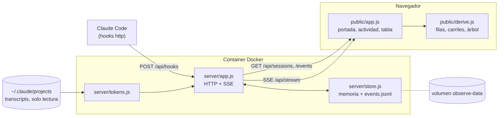

# Ominous Agent Observer

Observa en vivo lo que hacen tus sesiones de Claude Code: cada sesión, cada config cargada y cada herramienta ejecutada, en una línea de tiempo y una tabla de eventos.

> Estado: v0.1. Sin dependencias: Node y una imagen Docker.


## Arranque rápido

```bash
docker compose up -d --build
```

Abre <http://127.0.0.1:4982>. Por defecto solo escucha en localhost (ver `.env.example` para cambiar puerto o interfaz).

La portada es un árbol de todo lo que se ha ejecutado: un círculo por proyecto, sus sesiones en el borde, las vivas en el centro y los subagentes como radios. Un clic abre la sesión; el logo vuelve a la portada.

Para ver la vista con datos de ejemplo sin tocar Claude Code:

```bash
npm run demo          # envía una sesión de prueba a http://127.0.0.1:4982
```

Los eventos se guardan en el volumen `observe-data` (`/data/events.jsonl` dentro del container). Para borrarlos: `docker compose down -v`.

## Conectar los hooks de Claude Code

El servidor acepta el payload que Claude Code manda a sus hooks, tal cual, en `POST /api/hooks`. Añade esto a `~/.claude/settings.json` (todas las sesiones) o a `.claude/settings.json` de un proyecto:

```json
{
  "hooks": {
    "SessionStart":       [{ "hooks": [{ "type": "http", "url": "http://127.0.0.1:4982/api/hooks", "timeout": 2 }] }],
    "SessionEnd":         [{ "hooks": [{ "type": "http", "url": "http://127.0.0.1:4982/api/hooks", "timeout": 2 }] }],
    "UserPromptSubmit":   [{ "hooks": [{ "type": "http", "url": "http://127.0.0.1:4982/api/hooks", "timeout": 2 }] }],
    "InstructionsLoaded": [{ "hooks": [{ "type": "http", "url": "http://127.0.0.1:4982/api/hooks", "timeout": 2 }] }],
    "PreToolUse":         [{ "matcher": "*", "hooks": [{ "type": "http", "url": "http://127.0.0.1:4982/api/hooks", "timeout": 2 }] }],
    "PostToolUse":        [{ "matcher": "*", "hooks": [{ "type": "http", "url": "http://127.0.0.1:4982/api/hooks", "timeout": 2 }] }],
    "PostToolUseFailure": [{ "matcher": "*", "hooks": [{ "type": "http", "url": "http://127.0.0.1:4982/api/hooks", "timeout": 2 }] }],
    "Stop":               [{ "hooks": [{ "type": "http", "url": "http://127.0.0.1:4982/api/hooks", "timeout": 2 }] }],
    "SubagentStart":      [{ "hooks": [{ "type": "http", "url": "http://127.0.0.1:4982/api/hooks", "timeout": 2 }] }],
    "SubagentStop":       [{ "hooks": [{ "type": "http", "url": "http://127.0.0.1:4982/api/hooks", "timeout": 2 }] }]
  }
}
```

Si tu versión de Claude Code no admite hooks `http`, usa uno de tipo `command` con curl (mismo resultado):

```json
{ "type": "command", "command": "curl -s -m 2 -H 'content-type: application/json' --data-binary @- http://127.0.0.1:4982/api/hooks >/dev/null 2>&1 || true" }
```

El servidor responde `{}` a los hooks: no bloquea ni modifica nada de la sesión. Si el container está parado, el hook falla en silencio y la sesión sigue.

**Duración de cada evento**: la real, con el `duration_ms` que manda `PostToolUse` (Pre y Post se emparejan por `tool_use_id`). Si solo llega el `Pre`, se estima con el siguiente evento y se marca con `~`.

**Tokens de cada ejecución**: los hooks no traen tokens, así que el servidor lee (en solo lectura) el transcript de la sesión y asigna a cada herramienta los tokens del mensaje del modelo que la lanzó. La tabla muestra *entrada · salida* (la entrada incluye la caché) y el desglose al expandir la fila; si un mensaje lanzó varias herramientas a la vez, comparten sus tokens y llevan `≈`. Para esto `docker-compose.yml` monta `~/.claude/projects` en solo lectura; `OBSERVE_TOKENS=0` lo desactiva.

**Actividad**: como en agent-observe, un carril por agente (principal y subagentes). En modo **Auto** (por defecto) se despliega sola cuando el tráfico hace que los iconos se pisen, repartiéndolos en sub-filas, y se pliega cuando dejan de pisarse. **Desplegar**/**Plegar** lo fijan a mano y **Auto** lo devuelve al modo automático. El borde inferior se arrastra para cambiar el alto. En la URL, `?actividad=auto|desplegada|plegada`.

### Compatibilidad con agent-observe

`POST /api/events` acepta también el sobre que envía el plugin agent-observe (`{ agentClass, sessionId, agentId, hookName, cwd, payload }`), así que se puede usar el formato de eventos sin cambiarlo.

## Cómo está hecha



1. Cada hook de Claude Code hace un `POST` con su payload. `store.js` lo normaliza, recorta los textos enormes, lo guarda en memoria y lo añade a `events.jsonl`.
2. El servidor reenvía cada evento por SSE a las pestañas abiertas.
3. La vista pide el resto (sesiones, eventos, tokens) por la API y `derive.js` lo convierte en filas, carriles y el árbol. Es lógica pura, sin DOM, y la usan también el servidor y los tests.
4. Los tokens no vienen en los hooks: `tokens.js` los lee del transcript de la sesión, solo lo nuevo desde la última lectura.

| Archivo | Qué hace |
|---|---|
| `server/index.js` | Arranque y configuración por variables de entorno |
| `server/app.js` | Rutas HTTP, stream SSE, archivos estáticos y comprobaciones de Host y origen |
| `server/store.js` | Eventos en memoria con límite, por sesión, y persistencia en JSONL |
| `server/tokens.js` | Lectura incremental de transcripts y tokens por herramienta |
| `public/derive.js` | Emparejado Pre/Post, duraciones, carriles de actividad, resumen y disposición del árbol |
| `public/app.js` | Interfaz: portada, cabecera, actividad, filtros y tabla |
| `scripts/demo.js` | Envía una sesión de ejemplo |
| `test/` | Tests con `node:test` |

## Seguridad

Ve todo lo que hacen tus sesiones (comandos, salidas y prompts), así que está pensado para quedarse en tu equipo:

- **Solo localhost.** Docker publica el puerto en `127.0.0.1`. Para exponerlo hay que cambiar `OBSERVE_BIND` a propósito.
- **DNS rebinding.** Solo atiende peticiones dirigidas a `localhost`, `127.0.0.1` o `[::1]`. Otros nombres hay que declararlos en `OBSERVE_ALLOWED_HOSTS`.
- **Escritura desde otras webs.** `POST` exige `content-type: application/json` y rechaza otros orígenes, así que una página no puede inyectar eventos.
- **Transcripts en solo lectura.** Se montan con `:ro` y no se puede salir de la carpeta con `..`.
- **Imagen mínima.** Corre como el usuario `node`, sin npm, npx, yarn ni corepack. Cada PR pasa Trivy y CodeQL.
- **Límites.** Cuerpos de hasta 5 MB, textos recortados a 16 KB y un máximo de eventos en memoria (`OBSERVE_MAX_EVENTS`).

## Desarrollo

Sin dependencias: solo Node ≥ 22.

```bash
npm start     # servidor en http://127.0.0.1:4982 (solo memoria; OBSERVE_DATA_DIR=./data para persistir)
npm test
```

| Variable | Por defecto | Uso |
|---|---|---|
| `OBSERVE_PORT` | `4982` | Puerto (en Docker: puerto publicado en el host) |
| `OBSERVE_BIND` | `127.0.0.1` | Interfaz del host en Docker. `0.0.0.0` lo expone a la red |
| `OBSERVE_HOST` | `127.0.0.1` | Interfaz de escucha fuera de Docker |
| `OBSERVE_ALLOWED_HOSTS` | — | Nombres de host extra admitidos, separados por comas (solo si lo expones en la red) |
| `OBSERVE_DATA_DIR` | — (`/data` en Docker) | Carpeta del `events.jsonl` |
| `OBSERVE_MAX_EVENTS` | `50000` | Eventos máximos en memoria |
| `CLAUDE_PROJECTS_DIR` | `~/.claude/projects` | Transcripts que Docker monta en solo lectura para los tokens |
| `OBSERVE_TRANSCRIPTS_DIR` | — (`/claude-projects` en Docker) | Dónde lee el servidor los transcripts |
| `OBSERVE_TOKENS` | `1` | `0` desactiva la lectura de transcripts |

API: `GET /api/health`, `GET /api/sessions`, `GET /api/sessions/:id/events` (`?download=1` para exportar), `GET /api/sessions/:id/tokens`, `GET /api/stream` (SSE).

### CI

No hay despliegue: el proyecto corre en local. GitHub Actions comprueba cada PR y `main`:

- `ci`: tests en Node 22 y 24; zizmor sobre los workflows; imagen Docker con prueba de humo (salud, ingesta de un hook, bloqueo de Host ajeno y de escritura sin JSON) y escaneo Trivy de vulnerabilidades altas y críticas.
- `codeql`: análisis de seguridad del código, también una vez por semana. Solo corre con el repo público.
- Dependabot abre cada mes PRs para las acciones, la imagen base de Node y zizmor, solo con versiones publicadas hace al menos 7 días. Todo va fijado por SHA, digest o hash.
- `.github/rulesets/main.json` protege `main`: sin borrado ni force push, PR obligatoria y `test`, `audit` y `docker` en verde. Se aplica con `gh api -X POST repos/<dueño>/<repo>/rulesets --input .github/rulesets/main.json` (repo público o GitHub Pro).

Para contribuir, ver [`CONTRIBUTING.md`](CONTRIBUTING.md). Los cambios de cada versión están en [`CHANGELOG.md`](CHANGELOG.md).

## Licencia

MIT © 2026 AlexDBdevops. Ver `LICENSE`.
