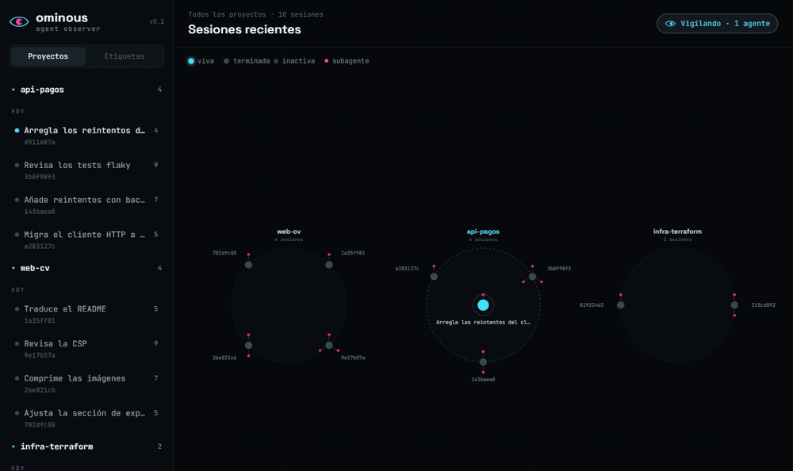
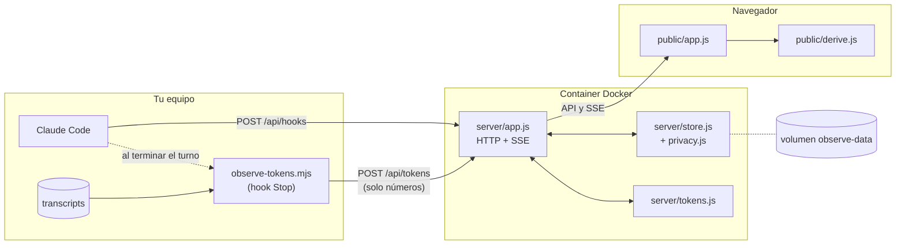

# Ominous Agent Observer

Observa en vivo lo que hacen tus sesiones de Claude Code: cada sesión, cada config cargada y cada herramienta ejecutada, en una línea de tiempo y una tabla de eventos.

> Estado: v0.1. Sin dependencias: Node y una imagen Docker.



## Arranque rápido

```bash
docker compose up -d --build
```

Abre <http://127.0.0.1:4982>. Por defecto solo escucha en localhost (ver `.env.example` para cambiar puerto o interfaz). Para que Claude Code le mande sus sesiones: `npm run hooks:install` (ver [Conectar los hooks](#conectar-los-hooks-de-claude-code)).

La portada es un árbol de todo lo que se ha ejecutado: un círculo por proyecto, sus sesiones en el borde, las vivas en el centro y los subagentes como radios. Un clic abre la sesión; el logo vuelve a la portada.

Para ver la vista con datos de ejemplo sin tocar Claude Code:

```bash
npm run demo          # envía una sesión de prueba a http://127.0.0.1:4982
```

Los eventos y los tokens se guardan en el volumen `observe-data` (`/data/events.jsonl` y `/data/tokens.json` dentro del container) y caducan a los 14 días. Para borrarlos ya: `docker compose down -v`.

## Conectar los hooks de Claude Code

Con el container arrancado:

```bash
npm run hooks:install
```

Añade a `~/.claude/settings.json` los hooks que alimentan la vista, sin tocar los que ya tengas, y guarda antes una copia de seguridad (`settings.json.bak-…`). Instalarlo dos veces no duplica nada. Las sesiones nuevas de Claude Code ya aparecen en la vista.

- **Eventos**: un hook `http` por evento (`SessionStart`, `PreToolUse`, `PostToolUse`, `Stop`, `SubagentStart`…) que manda el payload a `POST /api/hooks`.
- **Tokens**: en `Stop` y `SubagentStop`, un hook `command` que ejecuta `hooks/observe-tokens.mjs` (se copia a `~/.claude/hooks/`, así que sigue funcionando aunque muevas el repo). Ver más abajo.

Otras opciones: `node scripts/hooks.mjs install --dry-run` enseña qué cambiaría sin escribir nada; `--url http://127.0.0.1:5000` usa otro puerto; `CLAUDE_CONFIG_DIR` cambia la carpeta de Claude Code. Para quitarlo todo: `npm run hooks:uninstall`.

<details>
<summary>Configuración a mano (sin el instalador)</summary>

En `~/.claude/settings.json` (todas las sesiones) o en `.claude/settings.json` de un proyecto:

```json
{
  "hooks": {
    "SessionStart":       [{ "hooks": [{ "type": "http", "url": "http://127.0.0.1:4982/api/hooks", "timeout": 2 }] }],
    "SessionEnd":         [{ "hooks": [{ "type": "http", "url": "http://127.0.0.1:4982/api/hooks", "timeout": 2 }] }],
    "UserPromptSubmit":   [{ "hooks": [{ "type": "http", "url": "http://127.0.0.1:4982/api/hooks", "timeout": 2 }] }],
    "InstructionsLoaded": [{ "hooks": [{ "type": "http", "url": "http://127.0.0.1:4982/api/hooks", "timeout": 2 }] }],
    "PreToolUse":         [{ "matcher": "*", "hooks": [{ "type": "http", "url": "http://127.0.0.1:4982/api/hooks", "timeout": 2 }] }],
    "PostToolUse":        [{ "matcher": "*", "hooks": [{ "type": "http", "url": "http://127.0.0.1:4982/api/hooks", "timeout": 2 }] }],
    "PostToolUseFailure": [{ "matcher": "*", "hooks": [{ "type": "http", "url": "http://127.0.0.1:4982/api/hooks", "timeout": 2 }] }],
    "Stop": [{ "hooks": [
      { "type": "http", "url": "http://127.0.0.1:4982/api/hooks", "timeout": 2 },
      { "type": "command", "command": "node \"/ruta/a/ominous-observe-tokens.mjs\" http://127.0.0.1:4982", "timeout": 10 }
    ] }],
    "SubagentStart":      [{ "hooks": [{ "type": "http", "url": "http://127.0.0.1:4982/api/hooks", "timeout": 2 }] }],
    "SubagentStop": [{ "hooks": [
      { "type": "http", "url": "http://127.0.0.1:4982/api/hooks", "timeout": 2 },
      { "type": "command", "command": "node \"/ruta/a/ominous-observe-tokens.mjs\" http://127.0.0.1:4982", "timeout": 10 }
    ] }]
  }
}
```

Copia `hooks/observe-tokens.mjs` a esa ruta. Si tu versión de Claude Code no admite hooks `http`, usa uno `command` con curl: `curl -s -m 2 -H 'content-type: application/json' --data-binary @- http://127.0.0.1:4982/api/hooks >/dev/null 2>&1 || true`.

</details>

El servidor responde `{}` a los hooks: no bloquea ni modifica nada de la sesión. Si el container está parado, los hooks fallan en silencio y la sesión sigue.

**Duración de cada evento**: la real, con el `duration_ms` que manda `PostToolUse` (Pre y Post se emparejan por `tool_use_id`). Si solo llega el `Pre`, se estima con el siguiente evento y se marca con `~`.

**Tokens de cada ejecución**: los hooks no traen tokens. Al terminar cada turno, `hooks/observe-tokens.mjs` lee en tu equipo el transcript de la sesión (y los de sus subagentes) y manda a `POST /api/tokens` **solo números**: los tokens del mensaje del modelo que lanzó cada herramienta. El container nunca ve la conversación. La tabla muestra *entrada · salida* (la entrada incluye la caché) y el desglose al expandir la fila; si un mensaje lanzó varias herramientas a la vez, comparten sus tokens y llevan `≈`. Necesita Node ≥ 22 en el equipo; sin él, todo funciona salvo la columna de tokens.

**Qué se guarda**: por defecto (`OBSERVE_DETAIL=minimo`) solo lo que enseña la vista: herramienta, comando, ruta, duración, error y las primeras 12 líneas de la salida, con los secretos habituales tapados (`ghp_…`, `sk-…`, `AKIA…`, `Bearer …`, `password=…`, claves privadas). Del contenido que escriben `Write` y `Edit` solo se guarda el tamaño. Los eventos caducan a los 14 días (`OBSERVE_RETENTION_DAYS`). `OBSERVE_DETAIL=completo` guarda el payload entero, como agent-observe.

**Actividad**: como en agent-observe, un carril por agente (principal y subagentes). En modo **Auto** (por defecto) se despliega sola cuando el tráfico hace que los iconos se pisen, repartiéndolos en sub-filas, y se pliega cuando dejan de pisarse. **Desplegar**/**Plegar** lo fijan a mano y **Auto** lo devuelve al modo automático. El borde inferior se arrastra para cambiar el alto. En la URL, `?actividad=auto|desplegada|plegada`.

### Compatibilidad con agent-observe

`POST /api/events` acepta también el sobre que envía el plugin agent-observe (`{ agentClass, sessionId, agentId, hookName, cwd, payload }`), así que se puede usar el formato de eventos sin cambiarlo.

## Cómo está hecha



1. Cada hook de Claude Code hace un `POST` con su payload. `privacy.js` se queda solo con lo que enseña la vista y tapa los secretos; `store.js` lo guarda en memoria y lo añade a `events.jsonl`.
2. El servidor reenvía cada evento por SSE a las pestañas abiertas.
3. Al terminar cada turno, `observe-tokens.mjs` lee el transcript en tu equipo y manda solo los números de tokens; el servidor los valida, los guarda en `tokens.json` y avisa por SSE.
4. La vista pide el resto (sesiones, eventos, tokens) por la API y `derive.js` lo convierte en filas, carriles y el árbol. Es lógica pura, sin DOM, y la usan también el servidor y los tests.

| Archivo | Qué hace |
|---|---|
| `server/index.js` | Arranque y configuración por variables de entorno |
| `server/app.js` | Rutas HTTP, stream SSE, archivos estáticos y comprobaciones de Host y origen |
| `server/store.js` | Eventos en memoria por sesión, con límite y caducidad, y persistencia en JSONL |
| `server/privacy.js` | Qué se guarda de cada evento y tapado de secretos |
| `server/tokens.js` | Valida y guarda los tokens que manda el hook |
| `hooks/observe-tokens.mjs` | Hook del equipo: tokens por herramienta a partir del transcript |
| `scripts/hooks.mjs` | Instala y quita los hooks en `settings.json` |
| `public/derive.js` | Emparejado Pre/Post, duraciones, carriles de actividad, resumen y disposición del árbol |
| `public/app.js` | Interfaz: portada, cabecera, actividad, filtros y tabla |
| `scripts/demo.js` | Envía una sesión de ejemplo |
| `test/` | Tests con `node:test` |

## Seguridad

Ve lo que hacen tus sesiones (comandos, rutas y salidas), así que está pensado para quedarse en tu equipo y guardar lo mínimo:

- **Solo localhost.** Docker publica el puerto en `127.0.0.1`. Para exponerlo hay que cambiar `OBSERVE_BIND` a propósito.
- **DNS rebinding.** Solo atiende peticiones dirigidas a `localhost`, `127.0.0.1` o `[::1]`. Otros nombres hay que declararlos en `OBSERVE_ALLOWED_HOSTS`.
- **Escritura desde otras webs.** `POST` exige `content-type: application/json` y rechaza otros orígenes, así que una página no puede inyectar eventos ni tokens.
- **Sin acceso a tus conversaciones.** El container no monta nada de tu equipo. Los tokens llegan como números desde el hook, y el servidor rechaza cualquier campo que no lo sea.
- **Datos mínimos.** Por defecto solo guarda lo que se ve, con los secretos habituales tapados y sin el contenido de los ficheros que se escriben. Los eventos caducan a los 14 días.
- **Container endurecido.** Sistema de archivos de solo lectura (salvo `/data` y `/tmp`), sin capacidades de Linux, `no-new-privileges` y usuario `node`. La imagen no lleva npm, npx, yarn ni corepack. Cada PR pasa Trivy y CodeQL.
- **Límites.** Cuerpos de hasta 5 MB y un máximo de eventos en memoria (`OBSERVE_MAX_EVENTS`).

## Desarrollo

Sin dependencias: solo Node ≥ 22.

```bash
npm start     # servidor en http://127.0.0.1:4982 (solo memoria; OBSERVE_DATA_DIR=./data para persistir)
npm test
```

| Variable | Por defecto | Uso |
|---|---|---|
| `OBSERVE_PORT` | `4982` | Puerto (en Docker: puerto publicado en el host) |
| `OBSERVE_BIND` | `127.0.0.1` | Interfaz del host en Docker. `0.0.0.0` lo expone a la red |
| `OBSERVE_HOST` | `127.0.0.1` | Interfaz de escucha fuera de Docker |
| `OBSERVE_ALLOWED_HOSTS` | — | Nombres de host extra admitidos, separados por comas (solo si lo expones en la red) |
| `OBSERVE_DETAIL` | `minimo` | Qué se guarda de cada evento: `minimo` (lo que se ve, sin secretos) o `completo` (el payload entero) |
| `OBSERVE_RETENTION_DAYS` | `14` | Días que se guardan los eventos y sus tokens. `0` = sin caducidad |
| `OBSERVE_DATA_DIR` | — (`/data` en Docker) | Carpeta de `events.jsonl` y `tokens.json` |
| `OBSERVE_MAX_EVENTS` | `50000` | Eventos máximos en memoria |

API: `POST /api/hooks`, `POST /api/events`, `POST /api/tokens`, `GET /api/health`, `GET /api/sessions`, `GET /api/sessions/:id/events` (`?download=1` para exportar), `GET /api/sessions/:id/tokens`, `GET /api/stream` (SSE).

### CI

No hay despliegue: el proyecto corre en local. GitHub Actions comprueba cada PR y `main`:

- `ci`: tests en Node 22 y 24; zizmor sobre los workflows; imagen Docker con prueba de humo (salud, ingesta de un hook, bloqueo de Host ajeno y de escritura sin JSON) y escaneo Trivy de vulnerabilidades altas y críticas.
- `codeql`: análisis de seguridad del código, también una vez por semana. Solo corre con el repo público.
- Dependabot abre cada mes PRs para las acciones, la imagen base de Node y zizmor, solo con versiones publicadas hace al menos 7 días. Todo va fijado por SHA, digest o hash.
- `.github/rulesets/main.json` protege `main`: sin borrado ni force push, PR obligatoria y `test`, `audit` y `docker` en verde. Se aplica con `gh api -X POST repos/<dueño>/<repo>/rulesets --input .github/rulesets/main.json` (repo público o GitHub Pro).

Para contribuir, ver [`CONTRIBUTING.md`](CONTRIBUTING.md). Los cambios de cada versión están en [`CHANGELOG.md`](CHANGELOG.md).

## Licencia

MIT © 2026 AlexDBdevops. Ver `LICENSE`.
